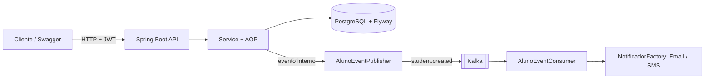

# Spring Boot 课堂测试 · 20 小时速成手册（零基础版）

> 目标：课堂上老师当场给一份 Java + Spring Boot 代码，你要在限时内**补全、跑通、上传云端**，并做 PIT 演示。
> 评分表满分 10 分：功能 4 + 非功能 2 + 架构 2 + 代码质量 1 + 演示 1。**约一半的分数靠"能跑起来 + 有证据"**。

## 0. 先看全局：包里有什么

| 目录 | 用途 |
|---|---|
| `solucao-completa/` | 完整参考答案（所有评分项都有对应代码）。**学习时对照它，不要一上来就抄。** |
| `cenario-A-quase-completo/` | 情况 A：老师给的代码大体完整，缺 AOP、Docker、索引迁移、README、测试 |
| `cenario-B-meio-pronto/` | 情况 B：只有 CRUD，没有安全/Kafka/Flyway/Docker/AOP，**并且藏了 5 个错误** |
| `cenario-C-esqueleto/` | 情况 C：骨架，pom 不全、实体没写完，编译不过 |
| `gabarito/GABARITO-B.md` | B 的 5 个错误的答案（做完再看） |
| `01-考场操作手册.md` | 考试当天怎么 15 分钟判断情况、每种情况的做题顺序、报错速查 |
| `02-PIT演示稿与葡语词汇.md` | 5 分钟演示稿（葡语）+ 常见问答 + 词汇表 |

**每一段末尾都有“本段完整代码”**：内容与 `solucao-completa/` 逐文件一致，可以直接在手册里对照学习、默写。

每个 `cenario-*` 里都有 `ROTEIRO.md`（葡语写的任务单，术语和考试一致）。

## 1. 20 小时时间表

| 段 | 内容 | 时长 | 累计 | 完成标志 |
|---|---|---|---|---|
| 0 | 装环境 + 跑起参考答案 | 1.5h | 1.5 | Swagger 页面能打开，能登录 |
| 1 | 读懂项目结构、三层、注解、依赖注入 | 2h | 3.5 | 能口述一个请求的完整路径 |
| 2 | JPA + PostgreSQL + Flyway + Docker | 2.5h | 6 | `docker compose up` 后表由 Flyway 创建 |
| 3 | CRUD + DTO + 校验 + 异常处理 | 2h | 8 | 能默写出一个模块的 5 个文件 |
| 4 | Spring Security + JWT | 2.5h | 10.5 | 无 token 401，ADMIN 才能删除 |
| 5 | AOP（POA） | 1h | 11.5 | 日志里看到 `[AOP]` |
| 6 | 设计模式（Builder/Strategy/Factory/Observer） | 1.5h | 13 | 能指着代码解释每个模式 |
| 7 | Kafka 事件 | 1.5h | 14.5 | 创建学生后日志里消费者收到事件 |
| 8 | 导出 CSV/PDF、报表、单元测试 | 1h | 15.5 | `/alunos/export` 能下载 |
| 9 | Git + GitHub + 云端 + README | 1.5h | 17 | 仓库里有 README 与规范提交 |
| 10 | 实战演练 B（限时 1.5h，先不看答案） | 1.5h | 18.5 | 5 个错误全找到 |
| 11 | 实战演练 C 前半（到登录+CRUD） + PIT 排练 | 1.5h | 20 | 5 分钟演示不出错 |

> 如果你只剩 10 小时：做 0、1、2、3、5、6、9、11，安全(4)和 Kafka(7) 只做"能抄、能讲"的程度。
> 每段结束前，**合上参考答案，凭记忆写一遍关键类**，这比读十遍更有效。

---

## 段 0（1.5h）装环境并跑起来

### 要装的东西
1. **JDK 21**（Temurin）。验证：`java -version`
2. **Maven 3.9+**。验证：`mvn -v`（Maven 要识别到 Java 21）
3. **Docker Desktop**。验证：`docker run hello-world`
4. **IntelliJ IDEA Community**（或 VS Code + Java 扩展包）
5. **Git**。验证：`git --version`
6. 一个 GitHub 账号

### 先跑最简单的方式（不需要 Docker）
```bash
cd solucao-completa
mvn clean package -DskipTests
mvn spring-boot:run -Dspring-boot.run.profiles=h2
```
- 打开 `http://localhost:8080/swagger-ui.html`
- `POST /auth/login`，body：`{"email":"admin@escola.com","senha":"admin123"}`，复制返回的 `token`
- 点右上角 **Authorize**，粘贴 token，再试 `POST /alunos`

`h2` 配置 = 内存数据库，不用装 PostgreSQL，Kafka 关闭。**这是考场上 Docker 出问题时的 Plan B。**

### 再跑完整方式
```bash
docker compose up -d db kafka
mvn spring-boot:run        # 连本机 5432 和 29092
```
或全部容器化：`docker compose up -d --build`。

⚠ 我在做这个包时的环境不能联网下载依赖，**没有真正编译过**。你第一次运行如遇依赖或编译报错，把完整日志发给我，我来修。


### 本段完整代码：项目骨架与配置

这 4 个文件是所有段落的地基。`pom.xml` 里已经包含后面各段要用的全部依赖（web、jpa、validation、security、aop、kafka、flyway、jwt、swagger、pdf）。

**`pom.xml`**

```xml
<?xml version="1.0" encoding="UTF-8"?>
<project xmlns="http://maven.apache.org/POM/4.0.0"
         xmlns:xsi="http://www.w3.org/2001/XMLSchema-instance"
         xsi:schemaLocation="http://maven.apache.org/POM/4.0.0 https://maven.apache.org/xsd/maven-4.0.0.xsd">
    <modelVersion>4.0.0</modelVersion>

    <parent>
        <groupId>org.springframework.boot</groupId>
        <artifactId>spring-boot-starter-parent</artifactId>
        <version>3.3.5</version>
        <relativePath/>
    </parent>

    <groupId>com.escola</groupId>
    <artifactId>escola</artifactId>
    <version>1.0.0</version>
    <name>escola</name>

    <properties>
        <java.version>21</java.version>
    </properties>

    <dependencies>
        <!-- Web / REST -->
        <dependency>
            <groupId>org.springframework.boot</groupId>
            <artifactId>spring-boot-starter-web</artifactId>
        </dependency>
        <!-- JPA (acesso ao banco) -->
        <dependency>
            <groupId>org.springframework.boot</groupId>
            <artifactId>spring-boot-starter-data-jpa</artifactId>
        </dependency>
        <!-- Validação: @Valid, @NotBlank, @Email -->
        <dependency>
            <groupId>org.springframework.boot</groupId>
            <artifactId>spring-boot-starter-validation</artifactId>
        </dependency>
        <!-- Segurança -->
        <dependency>
            <groupId>org.springframework.boot</groupId>
            <artifactId>spring-boot-starter-security</artifactId>
        </dependency>
        <!-- POA / AOP -->
        <dependency>
            <groupId>org.springframework.boot</groupId>
            <artifactId>spring-boot-starter-aop</artifactId>
        </dependency>
        <!-- Kafka -->
        <dependency>
            <groupId>org.springframework.kafka</groupId>
            <artifactId>spring-kafka</artifactId>
        </dependency>
        <!-- health check -->
        <dependency>
            <groupId>org.springframework.boot</groupId>
            <artifactId>spring-boot-starter-actuator</artifactId>
        </dependency>

        <!-- Banco: PostgreSQL + Flyway -->
        <dependency>
            <groupId>org.postgresql</groupId>
            <artifactId>postgresql</artifactId>
            <scope>runtime</scope>
        </dependency>
        <dependency>
            <groupId>org.flywaydb</groupId>
            <artifactId>flyway-core</artifactId>
        </dependency>
        <dependency>
            <groupId>org.flywaydb</groupId>
            <artifactId>flyway-database-postgresql</artifactId>
        </dependency>
        <!-- H2: plano B sem Docker (perfil "h2") -->
        <dependency>
            <groupId>com.h2database</groupId>
            <artifactId>h2</artifactId>
            <scope>runtime</scope>
        </dependency>

        <!-- JWT -->
        <dependency>
            <groupId>io.jsonwebtoken</groupId>
            <artifactId>jjwt-api</artifactId>
            <version>0.12.6</version>
        </dependency>
        <dependency>
            <groupId>io.jsonwebtoken</groupId>
            <artifactId>jjwt-impl</artifactId>
            <version>0.12.6</version>
            <scope>runtime</scope>
        </dependency>
        <dependency>
            <groupId>io.jsonwebtoken</groupId>
            <artifactId>jjwt-jackson</artifactId>
            <version>0.12.6</version>
            <scope>runtime</scope>
        </dependency>

        <!-- Swagger (documentação + demo) -->
        <dependency>
            <groupId>org.springdoc</groupId>
            <artifactId>springdoc-openapi-starter-webmvc-ui</artifactId>
            <version>2.6.0</version>
        </dependency>

        <!-- Exportação PDF -->
        <dependency>
            <groupId>com.github.librepdf</groupId>
            <artifactId>openpdf</artifactId>
            <version>1.3.30</version>
        </dependency>

        <dependency>
            <groupId>org.projectlombok</groupId>
            <artifactId>lombok</artifactId>
            <optional>true</optional>
        </dependency>

        <dependency>
            <groupId>org.springframework.boot</groupId>
            <artifactId>spring-boot-starter-test</artifactId>
            <scope>test</scope>
        </dependency>
    </dependencies>

    <build>
        <plugins>
            <plugin>
                <groupId>org.springframework.boot</groupId>
                <artifactId>spring-boot-maven-plugin</artifactId>
                <configuration>
                    <excludes>
                        <exclude>
                            <groupId>org.projectlombok</groupId>
                            <artifactId>lombok</artifactId>
                        </exclude>
                    </excludes>
                </configuration>
            </plugin>
        </plugins>
    </build>
</project>
```

**`src/main/java/com/escola/EscolaApplication.java`**

```java
package com.escola;

import org.springframework.boot.SpringApplication;
import org.springframework.boot.autoconfigure.SpringBootApplication;

@SpringBootApplication
public class EscolaApplication {
    public static void main(String[] args) {
        SpringApplication.run(EscolaApplication.class, args);
    }
}
```

**`src/main/resources/application.yml`**

```yaml
server:
  port: 8080

spring:
  application:
    name: escola
  datasource:
    url: ${DB_URL:jdbc:postgresql://localhost:5432/escola}
    username: ${DB_USER:app}
    password: ${DB_PASSWORD:app123}
  jpa:
    open-in-view: false
    hibernate:
      ddl-auto: validate        # o Flyway cria as tabelas; o Hibernate só confere
  flyway:
    enabled: true
  kafka:
    bootstrap-servers: ${KAFKA_SERVERS:localhost:29092}
    consumer:
      group-id: escola-notificacoes
      auto-offset-reset: earliest
    producer:
      properties:
        max.block.ms: 2000      # se o Kafka estiver fora, não trava a API

app:
  kafka:
    enabled: true
  jwt:
    secret: ${JWT_SECRET:troque-esta-chave-em-producao-com-32-bytes-ou-mais-ok}
    expiration-ms: 3600000      # 1 hora
  auth:
    exigir-verificacao-email: false

management:
  endpoints:
    web:
      exposure:
        include: health
```

**`src/main/resources/application-h2.yml`**

```yaml
# Plano B SEM Docker: mvn spring-boot:run -Dspring-boot.run.profiles=h2
spring:
  datasource:
    url: jdbc:h2:mem:escola;MODE=PostgreSQL;DB_CLOSE_DELAY=-1
    driver-class-name: org.h2.Driver
    username: sa
    password: ""
  kafka:
    listener:
      auto-startup: false

app:
  kafka:
    enabled: false
```

---

## 段 1（2h）读懂项目：Spring Boot 在做什么

### 1.1 一句话心智模型
一个 HTTP 请求的旅程：

```
浏览器/Swagger
  → JwtAuthFilter（检查 token）
  → AlunoController（接收 JSON、校验 @Valid）
  → AlunoService（业务规则、事务 @Transactional）
  → AlunoRepository（JPA 生成 SQL）
  → PostgreSQL
```
返回时反方向，实体 `Aluno` 被转换成 `AlunoDtos.Response`（DTO）。

### 1.2 必须认识的注解（背这张表）
| 注解 | 意思 |
|---|---|
| `@SpringBootApplication` | 程序入口，自动扫描本包及子包 |
| `@RestController` | 这个类是 REST 接口，返回 JSON |
| `@RequestMapping("/alunos")` | 路径前缀 |
| `@GetMapping/@PostMapping/@PutMapping/@DeleteMapping` | 对应 HTTP 方法 |
| `@RequestBody` | 把 JSON 变成 Java 对象 |
| `@PathVariable` / `@RequestParam` | 取路径中的 id / 查询参数 |
| `@Valid` | 触发校验（DTO 里的 `@NotBlank` 等） |
| `@Service` / `@Component` / `@Repository` | 交给 Spring 管理的"bean" |
| `@RequiredArgsConstructor`(Lombok) | 为 `final` 字段生成构造器 → 这就是**依赖注入** |
| `@Entity` / `@Table` / `@Id` | JPA 实体 / 表 / 主键 |
| `@Transactional` | 方法内的数据库操作要么全成功要么全回滚 |
| `@Configuration` / `@Bean` | 手写配置、手动创建 bean |

### 1.3 依赖注入是什么
你**不用** `new AlunoService()`。你在构造器里声明"我需要一个 AlunoService"，Spring 创建并塞给你。所以所有类上才要有 `@Service`/`@Component`——**忘了加，就是"找不到 bean"错误**。

### 1.4 练习（30 分钟）
1. 在 `AlunoController.buscar` 里打断点（IDEA 点行号左侧），用 Swagger 调 `GET /alunos/1`，用 Step Into 走一遍。
2. 用自己的话写出：请求从哪个类进、经过哪几个类、从哪个类出。
3. 把 `AlunoService.buscar` 里的异常消息改成别的，测一下返回的 404 变化。


### 本段完整代码：最小的“控制器 → 服务”例子（用来理解依赖注入）

先看这个 20 行的例子，再回头读 `AlunoController`（段 3）。在 `src/main/java/com/escola/ola/` 下新建两个文件，启动并登录拿到 token 后，访问 `GET /ola?nome=Ana`：

**`ola/OlaService.java`**

```java
package com.escola.ola;

import org.springframework.stereotype.Service;

@Service // 交给 Spring 管理 = 一个 bean
public class OlaService {
    public String saudar(String nome) {
        return "Olá, " + nome + "!";
    }
}
```

**`ola/OlaController.java`**

```java
package com.escola.ola;

import lombok.RequiredArgsConstructor;
import org.springframework.web.bind.annotation.GetMapping;
import org.springframework.web.bind.annotation.RequestMapping;
import org.springframework.web.bind.annotation.RequestParam;
import org.springframework.web.bind.annotation.RestController;

@RestController
@RequestMapping("/ola")
@RequiredArgsConstructor // 为 final 字段生成构造器 -> Spring 通过构造器注入 OlaService
public class OlaController {

    private final OlaService service; // 不写 new，Spring 帮你创建并传入

    @GetMapping
    public String ola(@RequestParam String nome) {
        return service.saudar(nome);
    }
}
```

**自测**：把 `OlaService` 上的 `@Service` 删掉再启动，会看到 `No qualifying bean of type OlaService`，这是考场上最常见的报错之一。

---

## 段 2（2.5h）数据库：JPA + PostgreSQL + Flyway + Docker

### 2.1 为什么要 Flyway
- 老办法：`ddl-auto: update`，Hibernate 偷偷改表，没有记录。
- Flyway：**SQL 文件就是表结构的历史**：`V1__create_tables.sql`、`V2__add_indexes.sql`…启动时按版本号顺序执行，并记录在表 `flyway_schema_history`。
- 评分表要看到的就是"PostgreSQL + Flyway 工作"，所以配置 `ddl-auto: validate`（只检查实体和表是否一致，不修改）。

命名规则（**错一个字符就不执行**）：`V<版本>__<描述>.sql`，注意是**两个下划线**，放在 `src/main/resources/db/migration/`。

### 2.2 Docker 最少知识
- **镜像**=安装包，**容器**=运行中的实例，`docker-compose.yml`=一次启动多个容器的清单。
- 常用命令：
  ```bash
  docker compose up -d --build   # 构建并后台启动
  docker compose ps              # 看状态
  docker compose logs -f backend # 看后端日志
  docker compose down            # 停止并删除容器（加 -v 连数据一起删）
  ```
- 容器之间用**服务名**互相访问（后端连 `db:5432`，不是 `localhost`）；你的电脑上跑的程序才用 `localhost`。

### 2.3 练习（1h）
1. 读 `docker-compose.yml` 逐行解释：`healthcheck` 为什么存在？（后端要等数据库就绪再启动）
2. 往 `V1` 之外新建 `V3__add_telefone.sql`：`ALTER TABLE alunos ADD COLUMN telefone VARCHAR(20);`，重启，用 `docker compose exec db psql -U app -d escola -c "\d alunos"` 看到新列。
3. **故意制造错误**：把 `Aluno` 实体里加个 `private String apelido;` 不写迁移，启动，会报 `Schema-validation: missing column`。理解 validate 的价值。


### 本段完整代码：实体、仓库、迁移、Docker

顺序：先写 `V1` 迁移 → 再写实体 `Aluno`（字段要和表一致）→ 仓库 → `docker compose up -d db` → 启动。

**`src/main/resources/db/migration/V1__create_tables.sql`**

```sql
CREATE TABLE usuarios (
    id                BIGINT GENERATED BY DEFAULT AS IDENTITY PRIMARY KEY,
    nome              VARCHAR(255) NOT NULL,
    email             VARCHAR(255) NOT NULL UNIQUE,
    senha             VARCHAR(255) NOT NULL,
    role              VARCHAR(20)  NOT NULL,
    email_verificado  BOOLEAN      NOT NULL DEFAULT FALSE
);

CREATE TABLE alunos (
    id             BIGINT GENERATED BY DEFAULT AS IDENTITY PRIMARY KEY,
    nome           VARCHAR(255) NOT NULL,
    email          VARCHAR(255) NOT NULL UNIQUE,
    matricula      VARCHAR(50)  NOT NULL,
    curso          VARCHAR(100) NOT NULL,
    data_cadastro  DATE         NOT NULL
);
```

**`src/main/resources/db/migration/V2__add_indexes.sql`**

```sql
-- Desempenho (RNF): buscas por nome e relatórios por curso
CREATE INDEX idx_alunos_nome  ON alunos (nome);
CREATE INDEX idx_alunos_curso ON alunos (curso);
```

**`src/main/java/com/escola/aluno/Aluno.java`**

```java
package com.escola.aluno;

import jakarta.persistence.*;
import lombok.*;

import java.time.LocalDate;

/**
 * PADRÃO BUILDER: Aluno.builder().nome("Ana").email("a@a.com")...build()
 * (gerado pelo Lombok com @Builder).
 */
@Entity
@Table(name = "alunos")
@Getter
@Setter
@NoArgsConstructor
@AllArgsConstructor
@Builder
public class Aluno {

    @Id
    @GeneratedValue(strategy = GenerationType.IDENTITY)
    private Long id;

    @Column(nullable = false)
    private String nome;

    @Column(nullable = false, unique = true)
    private String email;

    @Column(nullable = false)
    private String matricula;

    @Column(nullable = false)
    private String curso;

    @Column(name = "data_cadastro", nullable = false)
    @Builder.Default
    private LocalDate dataCadastro = LocalDate.now();
}
```

**`src/main/java/com/escola/aluno/AlunoRepository.java`**

```java
package com.escola.aluno;

import org.springframework.data.domain.Page;
import org.springframework.data.domain.Pageable;
import org.springframework.data.jpa.repository.JpaRepository;
import org.springframework.data.jpa.repository.Query;

import java.util.List;

public interface AlunoRepository extends JpaRepository<Aluno, Long> {

    // Spring Data gera o SQL a partir do NOME do método
    Page<Aluno> findByNomeContainingIgnoreCase(String nome, Pageable pageable);

    boolean existsByEmail(String email);

    interface CursoTotal {
        String getCurso();

        Long getTotal();
    }

    @Query("select a.curso as curso, count(a) as total from Aluno a group by a.curso order by a.curso")
    List<CursoTotal> totalPorCurso();
}
```

**`docker-compose.yml`**

```yaml
services:
  db:
    image: postgres:16
    environment:
      POSTGRES_DB: escola
      POSTGRES_USER: app
      POSTGRES_PASSWORD: app123
    ports:
      - "5432:5432"
    healthcheck:
      test: ["CMD-SHELL", "pg_isready -U app -d escola"]
      interval: 5s
      timeout: 5s
      retries: 10

  kafka:
    image: apache/kafka:3.8.0
    ports:
      - "29092:29092"   # acesso a partir do seu PC (localhost:29092)
    environment:
      KAFKA_NODE_ID: 1
      KAFKA_PROCESS_ROLES: broker,controller
      KAFKA_LISTENERS: PLAINTEXT://:9092,CONTROLLER://:9093,EXTERNAL://:29092
      KAFKA_ADVERTISED_LISTENERS: PLAINTEXT://kafka:9092,EXTERNAL://localhost:29092
      KAFKA_LISTENER_SECURITY_PROTOCOL_MAP: CONTROLLER:PLAINTEXT,PLAINTEXT:PLAINTEXT,EXTERNAL:PLAINTEXT
      KAFKA_INTER_BROKER_LISTENER_NAME: PLAINTEXT
      KAFKA_CONTROLLER_LISTENER_NAMES: CONTROLLER
      KAFKA_CONTROLLER_QUORUM_VOTERS: 1@kafka:9093
      KAFKA_OFFSETS_TOPIC_REPLICATION_FACTOR: 1
      KAFKA_TRANSACTION_STATE_LOG_REPLICATION_FACTOR: 1
      KAFKA_TRANSACTION_STATE_LOG_MIN_ISR: 1
      KAFKA_GROUP_INITIAL_REBALANCE_DELAY_MS: 0

  backend:
    build: .
    depends_on:
      db:
        condition: service_healthy
      kafka:
        condition: service_started
    environment:
      DB_URL: jdbc:postgresql://db:5432/escola
      DB_USER: app
      DB_PASSWORD: app123
      KAFKA_SERVERS: kafka:9092
      JWT_SECRET: troque-esta-chave-em-producao-com-32-bytes-ou-mais-ok
    ports:
      - "8080:8080"
```

**`Dockerfile`**

```dockerfile
# Estágio 1: compila com Maven
FROM maven:3.9-eclipse-temurin-21 AS build
WORKDIR /app
COPY pom.xml .
COPY src ./src
RUN mvn -q clean package -DskipTests

# Estágio 2: imagem final pequena, só com o JRE
FROM eclipse-temurin:21-jre
WORKDIR /app
COPY --from=build /app/target/*.jar app.jar
EXPOSE 8080
ENTRYPOINT ["java", "-jar", "app.jar"]
```

> `docker-compose.yml` 里的 `kafka` 服务到段 7 才用得上；学到这里可以先只启动数据库：`docker compose up -d db`。

---

## 段 3（2h）CRUD + DTO + 校验 + 异常

### 3.1 为什么用 DTO
实体直接对外暴露会泄露字段（如密码哈希）、被批量赋值攻击。DTO 只暴露需要的字段，还能放校验注解。

### 3.2 一个模块的 5 个文件（要能默写）
```
aluno/
  Aluno.java            实体
  AlunoRepository.java  extends JpaRepository<Aluno, Long>
  AlunoDtos.java        Request / Response
  AlunoService.java     业务 + @Transactional
  AlunoController.java  接口 + @Valid
```
考试里如果要加 `Professor`/`Turma`：**复制整个 aluno 包，全局替换名字**，改字段，加一个迁移文件。这是最快拿"CRUD/管理"分数的方法。

### 3.3 Spring Data 方法名魔法
`findByNomeContainingIgnoreCase(String nome, Pageable p)` → 自动生成 `where upper(nome) like upper('%…%')`。**名字拼错=启动失败**（B 包里有一个这样的错）。

### 3.4 统一异常处理
`GlobalExceptionHandler`(`@RestControllerAdvice`)：把 `NotFoundException` 变 404，`MethodArgumentNotValidException`（校验失败）变 400，`BusinessException` 变 409。评分表"Camadas、DTOs、验证"就看这些。

### 3.5 练习（1h）
1. 在 `Aluno` 里加字段 `telefone`（实体、DTO、迁移三处都要改）。
2. 复制 aluno 包做出 `professor` 包，从零跑通 CRUD。**计时**，目标 25 分钟内。


### 本段完整代码：DTO、服务、控制器、异常处理

这是一个完整模块的文件（实体和仓库在段 2）加 3 个异常类。目标：不看答案默写出来。

> 注意：这里的 `AlunoService` 和 `AlunoController` 是**最终版**，其中事件发布（段 7）和导出（段 6）相关的几行，做到那一段之前可以先注释掉，这样本段就能独立编译运行。

**`src/main/java/com/escola/aluno/AlunoDtos.java`**

```java
package com.escola.aluno;

import jakarta.validation.constraints.Email;
import jakarta.validation.constraints.NotBlank;

import java.time.LocalDate;

public final class AlunoDtos {

    private AlunoDtos() {
    }

    /** Entrada (POST/PUT). As anotações são as VALIDAÇÕES. */
    public record Request(@NotBlank(message = "nome é obrigatório") String nome,
                          @NotBlank @Email(message = "e-mail inválido") String email,
                          @NotBlank(message = "matrícula é obrigatória") String matricula,
                          @NotBlank(message = "curso é obrigatório") String curso) {
    }

    /** Saída. */
    public record Response(Long id, String nome, String email, String matricula,
                           String curso, LocalDate dataCadastro) {
        public static Response from(Aluno a) {
            return new Response(a.getId(), a.getNome(), a.getEmail(), a.getMatricula(),
                    a.getCurso(), a.getDataCadastro());
        }
    }
}
```

**`src/main/java/com/escola/aluno/AlunoService.java`**

```java
package com.escola.aluno;

import com.escola.event.AlunoCriadoEvent;
import com.escola.exception.BusinessException;
import com.escola.exception.NotFoundException;
import lombok.RequiredArgsConstructor;
import org.springframework.context.ApplicationEventPublisher;
import org.springframework.data.domain.Page;
import org.springframework.data.domain.Pageable;
import org.springframework.stereotype.Service;
import org.springframework.transaction.annotation.Transactional;

import java.util.List;

/** Regras de negócio. Controller chama Service; Service chama Repository. */
@Service
@RequiredArgsConstructor
public class AlunoService {

    private final AlunoRepository repo;
    private final ApplicationEventPublisher eventos;

    @Transactional(readOnly = true)
    public Page<Aluno> listar(String busca, Pageable pageable) {
        if (busca == null || busca.isBlank()) {
            return repo.findAll(pageable);
        }
        return repo.findByNomeContainingIgnoreCase(busca, pageable);
    }

    @Transactional(readOnly = true)
    public List<Aluno> listarTodos() {
        return repo.findAll();
    }

    @Transactional(readOnly = true)
    public Aluno buscar(Long id) {
        return repo.findById(id).orElseThrow(() -> new NotFoundException("Aluno " + id + " não encontrado"));
    }

    @Transactional
    public Aluno criar(AlunoDtos.Request r) {
        if (repo.existsByEmail(r.email())) {
            throw new BusinessException("E-mail já cadastrado");
        }
        Aluno salvo = repo.save(Aluno.builder()          // PADRÃO BUILDER
                .nome(r.nome())
                .email(r.email())
                .matricula(r.matricula())
                .curso(r.curso())
                .build());
        // PADRÃO OBSERVER: avisa quem estiver ouvindo (Kafka, notificação...)
        eventos.publishEvent(new AlunoCriadoEvent(salvo.getId(), salvo.getNome(), salvo.getEmail()));
        return salvo;
    }

    @Transactional
    public Aluno atualizar(Long id, AlunoDtos.Request r) {
        Aluno a = buscar(id);
        a.setNome(r.nome());
        a.setEmail(r.email());
        a.setMatricula(r.matricula());
        a.setCurso(r.curso());
        return a; // @Transactional salva sozinho ao final
    }

    @Transactional
    public void remover(Long id) {
        repo.delete(buscar(id)); // LGPD: direito de exclusão
    }
}
```

**`src/main/java/com/escola/aluno/AlunoController.java`**

```java
package com.escola.aluno;

import com.escola.export.ExportFactory;
import com.escola.export.ExportStrategy;
import jakarta.validation.Valid;
import lombok.RequiredArgsConstructor;
import org.springframework.data.domain.Page;
import org.springframework.data.domain.Pageable;
import org.springframework.http.HttpHeaders;
import org.springframework.http.HttpStatus;
import org.springframework.http.MediaType;
import org.springframework.http.ResponseEntity;
import org.springframework.security.access.prepost.PreAuthorize;
import org.springframework.web.bind.annotation.*;

@RestController
@RequestMapping("/alunos")
@RequiredArgsConstructor
public class AlunoController {

    private final AlunoService service;
    private final ExportFactory exportFactory;

    // GET /alunos?page=0&size=10&busca=ana
    @GetMapping
    public Page<AlunoDtos.Response> listar(@RequestParam(required = false) String busca, Pageable pageable) {
        return service.listar(busca, pageable).map(AlunoDtos.Response::from);
    }

    // GET /alunos/export?formato=csv|pdf   (declarado ANTES de /{id})
    @GetMapping("/export")
    public ResponseEntity<byte[]> exportar(@RequestParam(defaultValue = "csv") String formato) {
        ExportStrategy estrategia = exportFactory.obter(formato); // PADRÃO STRATEGY + FACTORY
        byte[] arquivo = estrategia.exportar(service.listarTodos());
        return ResponseEntity.ok()
                .header(HttpHeaders.CONTENT_DISPOSITION, "attachment; filename=alunos." + estrategia.formato())
                .contentType(MediaType.parseMediaType(estrategia.contentType()))
                .body(arquivo);
    }

    @GetMapping("/{id}")
    public AlunoDtos.Response buscar(@PathVariable Long id) {
        return AlunoDtos.Response.from(service.buscar(id));
    }

    @PostMapping
    @ResponseStatus(HttpStatus.CREATED)
    @PreAuthorize("hasAnyRole('ADMIN','PROFESSOR')")
    public AlunoDtos.Response criar(@Valid @RequestBody AlunoDtos.Request req) {
        return AlunoDtos.Response.from(service.criar(req));
    }

    @PutMapping("/{id}")
    @PreAuthorize("hasAnyRole('ADMIN','PROFESSOR')")
    public AlunoDtos.Response atualizar(@PathVariable Long id, @Valid @RequestBody AlunoDtos.Request req) {
        return AlunoDtos.Response.from(service.atualizar(id, req));
    }

    @DeleteMapping("/{id}")
    @ResponseStatus(HttpStatus.NO_CONTENT)
    @PreAuthorize("hasRole('ADMIN')")
    public void remover(@PathVariable Long id) {
        service.remover(id);
    }
}
```

**`src/main/java/com/escola/exception/NotFoundException.java`**

```java
package com.escola.exception;

public class NotFoundException extends RuntimeException {
    public NotFoundException(String mensagem) {
        super(mensagem);
    }
}
```

**`src/main/java/com/escola/exception/BusinessException.java`**

```java
package com.escola.exception;

/** Regra de negócio violada (ex.: e-mail duplicado). */
public class BusinessException extends RuntimeException {
    public BusinessException(String mensagem) {
        super(mensagem);
    }
}
```

**`src/main/java/com/escola/exception/GlobalExceptionHandler.java`**

```java
package com.escola.exception;

import org.springframework.http.HttpStatus;
import org.springframework.http.ResponseEntity;
import org.springframework.web.bind.MethodArgumentNotValidException;
import org.springframework.web.bind.annotation.ExceptionHandler;
import org.springframework.web.bind.annotation.RestControllerAdvice;

import java.util.HashMap;
import java.util.Map;

/** Um só lugar para transformar exceções em respostas HTTP limpas. */
@RestControllerAdvice
public class GlobalExceptionHandler {

    @ExceptionHandler(NotFoundException.class)
    public ResponseEntity<Map<String, String>> naoEncontrado(NotFoundException e) {
        return ResponseEntity.status(HttpStatus.NOT_FOUND).body(Map.of("erro", e.getMessage()));
    }

    @ExceptionHandler(BusinessException.class)
    public ResponseEntity<Map<String, String>> negocio(BusinessException e) {
        return ResponseEntity.status(HttpStatus.CONFLICT).body(Map.of("erro", e.getMessage()));
    }

    @ExceptionHandler(MethodArgumentNotValidException.class)
    public ResponseEntity<Map<String, String>> validacao(MethodArgumentNotValidException e) {
        Map<String, String> campos = new HashMap<>();
        e.getBindingResult().getFieldErrors()
                .forEach(f -> campos.put(f.getField(), f.getDefaultMessage()));
        return ResponseEntity.badRequest().body(campos);
    }
}
```

---

## 段 4（2.5h）Spring Security + JWT

### 4.1 概念
- **认证**：你是谁（登录，换 token）。**授权**：你能做什么（角色）。
- JWT = 一段签名的字符串，里面有用户邮箱和角色。服务器不存会话（无状态），所以易于水平扩展（评分表"Escalabilidade"）。

### 4.2 流程
```
POST /auth/login → 校验密码(BCrypt) → JwtService.gerar() → 返回 token
之后每个请求带 Header:  Authorization: Bearer <token>
JwtAuthFilter 读 token → 校验 → 把用户和角色放进 SecurityContext
@PreAuthorize("hasRole('ADMIN')") 决定放不放行
```

### 4.3 需要的 4 个类（参考答案）
| 类 | 作用 |
|---|---|
| `JwtService` | 生成、验证 token |
| `JwtAuthFilter` | 每个请求前读取 token |
| `SecurityConfig` | 哪些路径公开（`/auth/**`、swagger），其余要登录；`BCryptPasswordEncoder` |
| `User` + `UserRepository` | 用户表（`senha` 存哈希） |

### 4.4 评分表里的"找回密码、邮箱验证"
参考答案做了**简化版**：令牌放内存，"发邮件"打印到日志。README 里**老实写明**是模拟。时间不够就只做登录+角色，并在 README 写"设计了但未实现"。

### 4.5 练习（1h）
1. 不看答案，在 B 包里实现登录 + 保护 `/alunos`。（预期会卡住——卡住了再看对应文件。）
2. 用 Swagger：无 token → 401；用 `prof@escola.com` 删除学生 → 403；用 admin → 204。


### 本段完整代码：认证与授权（JWT）

建议顺序：`Role` → `User` → `UserRepository` → `JwtService` → `JwtAuthFilter` → `SecurityConfig` → `AuthDtos` → `AuthService` → `AuthController` → `DataSeeder`。完成后测试：无 token 401，PROFESSOR 删除 403，ADMIN 删除 204。

**`src/main/java/com/escola/user/Role.java`**

```java
package com.escola.user;

public enum Role {
    ADMIN, PROFESSOR, ALUNO
}
```

**`src/main/java/com/escola/user/User.java`**

```java
package com.escola.user;

import jakarta.persistence.*;
import lombok.*;

@Entity
@Table(name = "usuarios")
@Getter
@Setter
@NoArgsConstructor
@AllArgsConstructor
@Builder
public class User {

    @Id
    @GeneratedValue(strategy = GenerationType.IDENTITY)
    private Long id;

    @Column(nullable = false)
    private String nome;

    @Column(nullable = false, unique = true)
    private String email;

    @Column(nullable = false)
    private String senha; // sempre o hash BCrypt, nunca a senha pura

    @Enumerated(EnumType.STRING)
    @Column(nullable = false)
    private Role role;

    @Column(name = "email_verificado", nullable = false)
    private boolean emailVerificado;
}
```

**`src/main/java/com/escola/user/UserRepository.java`**

```java
package com.escola.user;

import org.springframework.data.jpa.repository.JpaRepository;

import java.util.Optional;

public interface UserRepository extends JpaRepository<User, Long> {
    Optional<User> findByEmail(String email);

    boolean existsByEmail(String email);
}
```

**`src/main/java/com/escola/security/JwtService.java`**

```java
package com.escola.security;

import com.escola.user.User;
import io.jsonwebtoken.Claims;
import io.jsonwebtoken.Jwts;
import io.jsonwebtoken.security.Keys;
import org.springframework.beans.factory.annotation.Value;
import org.springframework.stereotype.Service;

import javax.crypto.SecretKey;
import java.nio.charset.StandardCharsets;
import java.util.Date;

/** Gera e valida tokens JWT (assinados com HMAC-SHA). */
@Service
public class JwtService {

    private final SecretKey key;
    private final long expirationMs;

    public JwtService(@Value("${app.jwt.secret}") String secret,
                      @Value("${app.jwt.expiration-ms}") long expirationMs) {
        this.key = Keys.hmacShaKeyFor(secret.getBytes(StandardCharsets.UTF_8));
        this.expirationMs = expirationMs;
    }

    public String gerar(User user) {
        Date agora = new Date();
        return Jwts.builder()
                .subject(user.getEmail())
                .claim("role", user.getRole().name())
                .issuedAt(agora)
                .expiration(new Date(agora.getTime() + expirationMs))
                .signWith(key)
                .compact();
    }

    /** Lança JwtException se o token for inválido ou expirado. */
    public Claims validar(String token) {
        return Jwts.parser()
                .verifyWith(key)
                .build()
                .parseSignedClaims(token)
                .getPayload();
    }
}
```

**`src/main/java/com/escola/security/JwtAuthFilter.java`**

```java
package com.escola.security;

import io.jsonwebtoken.Claims;
import io.jsonwebtoken.JwtException;
import jakarta.servlet.FilterChain;
import jakarta.servlet.ServletException;
import jakarta.servlet.http.HttpServletRequest;
import jakarta.servlet.http.HttpServletResponse;
import lombok.RequiredArgsConstructor;
import org.springframework.security.authentication.UsernamePasswordAuthenticationToken;
import org.springframework.security.core.authority.SimpleGrantedAuthority;
import org.springframework.security.core.context.SecurityContextHolder;
import org.springframework.stereotype.Component;
import org.springframework.web.filter.OncePerRequestFilter;

import java.io.IOException;
import java.util.List;

/** Lê o header "Authorization: Bearer <token>" e autentica a requisição. */
@Component
@RequiredArgsConstructor
public class JwtAuthFilter extends OncePerRequestFilter {

    private final JwtService jwtService;

    @Override
    protected void doFilterInternal(HttpServletRequest request,
                                    HttpServletResponse response,
                                    FilterChain chain) throws ServletException, IOException {
        String header = request.getHeader("Authorization");
        if (header != null && header.startsWith("Bearer ")) {
            try {
                Claims claims = jwtService.validar(header.substring(7));
                var auth = new UsernamePasswordAuthenticationToken(
                        claims.getSubject(),
                        null,
                        List.of(new SimpleGrantedAuthority("ROLE_" + claims.get("role", String.class))));
                SecurityContextHolder.getContext().setAuthentication(auth);
            } catch (JwtException | IllegalArgumentException e) {
                SecurityContextHolder.clearContext();
            }
        }
        chain.doFilter(request, response);
    }
}
```

**`src/main/java/com/escola/config/SecurityConfig.java`**

```java
package com.escola.config;

import com.escola.security.JwtAuthFilter;
import lombok.RequiredArgsConstructor;
import org.springframework.context.annotation.Bean;
import org.springframework.context.annotation.Configuration;
import org.springframework.http.HttpStatus;
import org.springframework.security.config.annotation.method.configuration.EnableMethodSecurity;
import org.springframework.security.config.annotation.web.builders.HttpSecurity;
import org.springframework.security.config.annotation.web.configurers.AbstractHttpConfigurer;
import org.springframework.security.config.http.SessionCreationPolicy;
import org.springframework.security.crypto.bcrypt.BCryptPasswordEncoder;
import org.springframework.security.crypto.password.PasswordEncoder;
import org.springframework.security.web.SecurityFilterChain;
import org.springframework.security.web.authentication.HttpStatusEntryPoint;
import org.springframework.security.web.authentication.UsernamePasswordAuthenticationFilter;

@Configuration
@EnableMethodSecurity // habilita @PreAuthorize
@RequiredArgsConstructor
public class SecurityConfig {

    private final JwtAuthFilter jwtAuthFilter;

    @Bean
    public PasswordEncoder passwordEncoder() {
        return new BCryptPasswordEncoder();
    }

    @Bean
    public SecurityFilterChain filterChain(HttpSecurity http) throws Exception {
        http
            .csrf(AbstractHttpConfigurer::disable) // API stateless com JWT
            .sessionManagement(s -> s.sessionCreationPolicy(SessionCreationPolicy.STATELESS))
            .authorizeHttpRequests(a -> a
                .requestMatchers("/auth/**", "/swagger-ui/**", "/swagger-ui.html",
                                 "/v3/api-docs/**", "/actuator/health").permitAll()
                .anyRequest().authenticated())
            .exceptionHandling(e -> e.authenticationEntryPoint(new HttpStatusEntryPoint(HttpStatus.UNAUTHORIZED)))
            .addFilterBefore(jwtAuthFilter, UsernamePasswordAuthenticationFilter.class);
        return http.build();
    }
}
```

**`src/main/java/com/escola/auth/AuthDtos.java`**

```java
package com.escola.auth;

import jakarta.validation.constraints.Email;
import jakarta.validation.constraints.NotBlank;
import jakarta.validation.constraints.Size;

/** DTOs = objetos que entram/saem da API (nunca expomos a Entity direto). */
public final class AuthDtos {

    private AuthDtos() {
    }

    public record Register(@NotBlank String nome,
                           @NotBlank @Email String email,
                           @NotBlank @Size(min = 6, message = "mínimo 6 caracteres") String senha) {
    }

    public record Login(@NotBlank @Email String email, @NotBlank String senha) {
    }

    public record TokenResponse(String token, String tipo, String role) {
    }

    public record ForgotPassword(@NotBlank @Email String email) {
    }

    public record ResetPassword(@NotBlank String token,
                                @NotBlank @Size(min = 6, message = "mínimo 6 caracteres") String novaSenha) {
    }

    public record Mensagem(String mensagem) {
    }
}
```

**`src/main/java/com/escola/auth/AuthService.java`**

```java
package com.escola.auth;

import com.escola.exception.BusinessException;
import com.escola.security.JwtService;
import com.escola.user.Role;
import com.escola.user.User;
import com.escola.user.UserRepository;
import lombok.RequiredArgsConstructor;
import lombok.extern.slf4j.Slf4j;
import org.springframework.beans.factory.annotation.Value;
import org.springframework.http.HttpStatus;
import org.springframework.security.crypto.password.PasswordEncoder;
import org.springframework.stereotype.Service;
import org.springframework.transaction.annotation.Transactional;
import org.springframework.web.server.ResponseStatusException;

import java.util.Map;
import java.util.UUID;
import java.util.concurrent.ConcurrentHashMap;

@Service
@RequiredArgsConstructor
@Slf4j
public class AuthService {

    private final UserRepository users;
    private final PasswordEncoder encoder;
    private final JwtService jwtService;

    // Tokens de verificação / recuperação ficam em memória (simplificação documentada no README).
    // Em produção: tabela no banco com validade + envio real de e-mail.
    private final Map<String, String> tokensVerificacao = new ConcurrentHashMap<>();
    private final Map<String, String> tokensRecuperacao = new ConcurrentHashMap<>();

    @Value("${app.auth.exigir-verificacao-email:false}")
    private boolean exigirVerificacao;

    @Transactional
    public AuthDtos.Mensagem registrar(AuthDtos.Register req) {
        if (users.existsByEmail(req.email())) {
            throw new BusinessException("E-mail já cadastrado");
        }
        // O papel NÃO vem da requisição: auto-cadastro é sempre ALUNO (segurança).
        users.save(User.builder()
                .nome(req.nome())
                .email(req.email())
                .senha(encoder.encode(req.senha()))
                .role(Role.ALUNO)
                .emailVerificado(false)
                .build());

        String token = UUID.randomUUID().toString();
        tokensVerificacao.put(token, req.email());
        log.info("[EMAIL SIMULADO] Verificar e-mail: GET /auth/verificar-email?token={}", token);
        return new AuthDtos.Mensagem("Cadastro realizado. Verifique seu e-mail.");
    }

    @Transactional
    public AuthDtos.Mensagem verificarEmail(String token) {
        String email = tokensVerificacao.remove(token);
        if (email == null) {
            throw new BusinessException("Token inválido");
        }
        users.findByEmail(email).ifPresent(u -> u.setEmailVerificado(true));
        return new AuthDtos.Mensagem("E-mail verificado");
    }

    @Transactional(readOnly = true)
    public AuthDtos.TokenResponse login(AuthDtos.Login req) {
        User user = users.findByEmail(req.email())
                .filter(u -> encoder.matches(req.senha(), u.getSenha()))
                .orElseThrow(() -> new ResponseStatusException(HttpStatus.UNAUTHORIZED, "Credenciais inválidas"));
        if (exigirVerificacao && !user.isEmailVerificado()) {
            throw new ResponseStatusException(HttpStatus.FORBIDDEN, "E-mail ainda não verificado");
        }
        return new AuthDtos.TokenResponse(jwtService.gerar(user), "Bearer", user.getRole().name());
    }

    public AuthDtos.Mensagem esqueciSenha(AuthDtos.ForgotPassword req) {
        // Resposta sempre igual, para não revelar se o e-mail existe.
        users.findByEmail(req.email()).ifPresent(u -> {
            String token = UUID.randomUUID().toString();
            tokensRecuperacao.put(token, u.getEmail());
            log.info("[EMAIL SIMULADO] Redefinir senha: POST /auth/redefinir-senha token={}", token);
        });
        return new AuthDtos.Mensagem("Se o e-mail existir, enviaremos instruções.");
    }

    @Transactional
    public AuthDtos.Mensagem redefinirSenha(AuthDtos.ResetPassword req) {
        String email = tokensRecuperacao.remove(req.token());
        if (email == null) {
            throw new BusinessException("Token inválido");
        }
        users.findByEmail(email).ifPresent(u -> u.setSenha(encoder.encode(req.novaSenha())));
        return new AuthDtos.Mensagem("Senha redefinida");
    }
}
```

**`src/main/java/com/escola/auth/AuthController.java`**

```java
package com.escola.auth;

import jakarta.validation.Valid;
import lombok.RequiredArgsConstructor;
import org.springframework.http.HttpStatus;
import org.springframework.web.bind.annotation.*;

@RestController
@RequestMapping("/auth")
@RequiredArgsConstructor
public class AuthController {

    private final AuthService service;

    @PostMapping("/registrar")
    @ResponseStatus(HttpStatus.CREATED)
    public AuthDtos.Mensagem registrar(@Valid @RequestBody AuthDtos.Register req) {
        return service.registrar(req);
    }

    @GetMapping("/verificar-email")
    public AuthDtos.Mensagem verificar(@RequestParam String token) {
        return service.verificarEmail(token);
    }

    @PostMapping("/login")
    public AuthDtos.TokenResponse login(@Valid @RequestBody AuthDtos.Login req) {
        return service.login(req);
    }

    @PostMapping("/esqueci-senha")
    public AuthDtos.Mensagem esqueciSenha(@Valid @RequestBody AuthDtos.ForgotPassword req) {
        return service.esqueciSenha(req);
    }

    @PostMapping("/redefinir-senha")
    public AuthDtos.Mensagem redefinir(@Valid @RequestBody AuthDtos.ResetPassword req) {
        return service.redefinirSenha(req);
    }
}
```

**`src/main/java/com/escola/config/DataSeeder.java`**

```java
package com.escola.config;

import com.escola.user.Role;
import com.escola.user.User;
import com.escola.user.UserRepository;
import lombok.RequiredArgsConstructor;
import org.springframework.boot.CommandLineRunner;
import org.springframework.security.crypto.password.PasswordEncoder;
import org.springframework.stereotype.Component;

/** Cria usuários de demonstração na primeira execução. */
@Component
@RequiredArgsConstructor
public class DataSeeder implements CommandLineRunner {

    private final UserRepository users;
    private final PasswordEncoder encoder;

    @Override
    public void run(String... args) {
        criarSeNaoExistir("Administrador", "admin@escola.com", "admin123", Role.ADMIN);
        criarSeNaoExistir("Professor Demo", "prof@escola.com", "prof123", Role.PROFESSOR);
    }

    private void criarSeNaoExistir(String nome, String email, String senha, Role role) {
        if (!users.existsByEmail(email)) {
            users.save(User.builder()
                    .nome(nome)
                    .email(email)
                    .senha(encoder.encode(senha))
                    .role(role)
                    .emailVerificado(true)
                    .build());
        }
    }
}
```

---

## 段 5（1h）AOP（POA）

### 5.1 概念
**横切关注点**（日志、计时、审计）不应混在业务代码里。AOP 让你"拦截"一批方法，在前后加逻辑。

### 5.2 最小可得分版本（15 行）
```java
@Aspect
@Component
@Slf4j
public class LogAspect {
    @Around("execution(* com.escola..*Service.*(..))")
    public Object medirTempo(ProceedingJoinPoint pjp) throws Throwable {
        long ini = System.currentTimeMillis();
        try { return pjp.proceed(); }
        finally { log.info("[AOP] {} {}ms", pjp.getSignature().toShortString(), System.currentTimeMillis() - ini); }
    }
}
```
依赖：`spring-boot-starter-aop`。读懂切点表达式：`*` 任意返回类型，`com.escola..*Service` 任意子包下以 Service 结尾的类，`.*(..)` 任意方法任意参数。

### 5.3 说法（演示时用）
"AOP 把性能监控和审计从业务代码中分离；LogAspect 同时是'响应时间 < 2 s'的证据。"


### 本段完整代码：AOP（POA）

依赖已在 `pom.xml` 中（`spring-boot-starter-aop`）。两个类放进 `aop/` 包，重启后看日志里的 `[AOP]` 和 `[AUDITORIA]`。

**`src/main/java/com/escola/aop/LogAspect.java`**

```java
package com.escola.aop;

import lombok.extern.slf4j.Slf4j;
import org.aspectj.lang.ProceedingJoinPoint;
import org.aspectj.lang.annotation.Around;
import org.aspectj.lang.annotation.Aspect;
import org.springframework.stereotype.Component;

/**
 * POA / AOP: preocupação transversal (log + tempo) fora da regra de negócio.
 * Intercepta todo método de classes *Service. Também prova o RNF "resposta < 2s".
 */
@Aspect
@Component
@Slf4j
public class LogAspect {

    private static final long LIMITE_MS = 2000;

    @Around("execution(* com.escola..*Service.*(..))")
    public Object medirTempo(ProceedingJoinPoint pjp) throws Throwable {
        long inicio = System.currentTimeMillis();
        try {
            return pjp.proceed();
        } finally {
            long ms = System.currentTimeMillis() - inicio;
            if (ms > LIMITE_MS) {
                log.warn("[AOP] {} LENTO: {}ms", pjp.getSignature().toShortString(), ms);
            } else {
                log.info("[AOP] {} executou em {}ms", pjp.getSignature().toShortString(), ms);
            }
        }
    }
}
```

**`src/main/java/com/escola/aop/AuditAspect.java`**

```java
package com.escola.aop;

import lombok.extern.slf4j.Slf4j;
import org.aspectj.lang.JoinPoint;
import org.aspectj.lang.annotation.AfterReturning;
import org.aspectj.lang.annotation.Aspect;
import org.springframework.security.core.Authentication;
import org.springframework.security.core.context.SecurityContextHolder;
import org.springframework.stereotype.Component;

/** Auditoria: registra QUEM alterou dados (útil para LGPD). */
@Aspect
@Component
@Slf4j
public class AuditAspect {

    @AfterReturning("execution(* com.escola.aluno.AlunoService.criar(..)) "
            + "|| execution(* com.escola.aluno.AlunoService.atualizar(..)) "
            + "|| execution(* com.escola.aluno.AlunoService.remover(..))")
    public void auditar(JoinPoint jp) {
        Authentication auth = SecurityContextHolder.getContext().getAuthentication();
        String quem = (auth != null) ? auth.getName() : "anonimo";
        log.info("[AUDITORIA] usuario={} acao={}", quem, jp.getSignature().getName());
    }
}
```

---

## 段 6（1.5h）设计模式：评分要求"至少 3 个"

| 模式 | 代码里怎么认 | 一句话理由 |
|---|---|---|
| **Builder** | `Aluno.builder().nome(..).build()`（Lombok `@Builder`） | 字段多，创建可读 |
| **Strategy** | `ExportStrategy` ← `CsvExport`、`PdfExport` | 新格式只加一个类 |
| **Factory** | `ExportFactory.obter("pdf")`、`NotificadorFactory.criar("EMAIL")` | 不用 if/else 选实现 |
| **Observer** | `eventos.publishEvent(...)` + `@EventListener` | 创建学生与"发通知/发 Kafka"解耦 |
| **Singleton** | Spring 的 bean 默认单例 | 免费的，可以提一句 |

**考场技巧**：老师的代码里通常已经有一些模式（尤其 Builder/Singleton）。先找出来命名，再补 1~2 个（Strategy+Factory 最省事，同时满足"导出 PDF/CSV"）。README 写表：模式 → 类 → 理由。

### 练习（30 分钟）
在 B 包里不看答案，加一个 `JsonExport`（json 格式）——你应该只需要**新增一个类**，不改任何旧类。这就是 Strategy 的价值。


### 本段完整代码：设计模式：Strategy / Factory（导出）与 Factory（通知）

Builder 在 `Aluno`/`User` 的 `@Builder` 里，Observer 在段 7 的事件里。本段 8 个文件展示 Strategy + Factory：新增 `JsonExport` 只需要加一个类，不改旧代码。

**`src/main/java/com/escola/export/ExportStrategy.java`**

```java
package com.escola.export;

import com.escola.aluno.Aluno;

import java.util.List;

/** PADRÃO STRATEGY: cada formato de exportação é uma "estratégia" intercambiável. */
public interface ExportStrategy {
    String formato();      // "csv", "pdf"

    String contentType();  // "text/csv", "application/pdf"

    byte[] exportar(List<Aluno> alunos);
}
```

**`src/main/java/com/escola/export/CsvExport.java`**

```java
package com.escola.export;

import com.escola.aluno.Aluno;
import org.springframework.stereotype.Component;

import java.nio.charset.StandardCharsets;
import java.util.List;

@Component
public class CsvExport implements ExportStrategy {

    @Override
    public String formato() {
        return "csv";
    }

    @Override
    public String contentType() {
        return "text/csv";
    }

    @Override
    public byte[] exportar(List<Aluno> alunos) {
        StringBuilder sb = new StringBuilder("id;nome;email;matricula;curso\n");
        for (Aluno a : alunos) {
            sb.append(a.getId()).append(';')
              .append(a.getNome()).append(';')
              .append(a.getEmail()).append(';')
              .append(a.getMatricula()).append(';')
              .append(a.getCurso()).append('\n');
        }
        return sb.toString().getBytes(StandardCharsets.UTF_8);
    }
}
```

**`src/main/java/com/escola/export/PdfExport.java`**

```java
package com.escola.export;

import com.escola.aluno.Aluno;
import com.lowagie.text.Document;
import com.lowagie.text.Paragraph;
import com.lowagie.text.pdf.PdfWriter;
import org.springframework.stereotype.Component;

import java.io.ByteArrayOutputStream;
import java.util.List;

@Component
public class PdfExport implements ExportStrategy {

    @Override
    public String formato() {
        return "pdf";
    }

    @Override
    public String contentType() {
        return "application/pdf";
    }

    @Override
    public byte[] exportar(List<Aluno> alunos) {
        ByteArrayOutputStream out = new ByteArrayOutputStream();
        Document doc = new Document();
        PdfWriter.getInstance(doc, out);
        doc.open();
        doc.add(new Paragraph("Relatório de Alunos"));
        doc.add(new Paragraph(" "));
        for (Aluno a : alunos) {
            doc.add(new Paragraph(a.getMatricula() + " - " + a.getNome()
                    + " (" + a.getCurso() + ") - " + a.getEmail()));
        }
        doc.close();
        return out.toByteArray();
    }
}
```

**`src/main/java/com/escola/export/ExportFactory.java`**

```java
package com.escola.export;

import com.escola.exception.BusinessException;
import org.springframework.stereotype.Component;

import java.util.List;
import java.util.Map;
import java.util.function.Function;
import java.util.stream.Collectors;

/** Escolhe a estratégia certa pelo nome do formato. */
@Component
public class ExportFactory {

    private final Map<String, ExportStrategy> estrategias;

    public ExportFactory(List<ExportStrategy> lista) {
        this.estrategias = lista.stream()
                .collect(Collectors.toMap(e -> e.formato().toLowerCase(), Function.identity()));
    }

    public ExportStrategy obter(String formato) {
        ExportStrategy e = estrategias.get(formato.toLowerCase());
        if (e == null) {
            throw new BusinessException("Formato não suportado: " + formato);
        }
        return e;
    }
}
```

**`src/main/java/com/escola/notificacao/Notificador.java`**

```java
package com.escola.notificacao;

public interface Notificador {
    String canal();

    void enviar(String destino, String mensagem);
}
```

**`src/main/java/com/escola/notificacao/EmailNotificador.java`**

```java
package com.escola.notificacao;

import lombok.extern.slf4j.Slf4j;
import org.springframework.stereotype.Component;

@Component
@Slf4j
public class EmailNotificador implements Notificador {
    @Override
    public String canal() {
        return "EMAIL";
    }

    @Override
    public void enviar(String destino, String mensagem) {
        log.info("[NOTIFICAÇÃO][EMAIL] para={} | {}", destino, mensagem); // simulado
    }
}
```

**`src/main/java/com/escola/notificacao/SmsNotificador.java`**

```java
package com.escola.notificacao;

import lombok.extern.slf4j.Slf4j;
import org.springframework.stereotype.Component;

@Component
@Slf4j
public class SmsNotificador implements Notificador {
    @Override
    public String canal() {
        return "SMS";
    }

    @Override
    public void enviar(String destino, String mensagem) {
        log.info("[NOTIFICAÇÃO][SMS] para={} | {}", destino, mensagem); // simulado
    }
}
```

**`src/main/java/com/escola/notificacao/NotificadorFactory.java`**

```java
package com.escola.notificacao;

import org.springframework.stereotype.Component;

import java.util.List;
import java.util.Map;
import java.util.function.Function;
import java.util.stream.Collectors;

/** PADRÃO FACTORY: "me dê o notificador do canal X" sem usar if/else espalhado. */
@Component
public class NotificadorFactory {

    private final Map<String, Notificador> porCanal;

    // O Spring injeta TODOS os beans que implementam Notificador
    public NotificadorFactory(List<Notificador> notificadores) {
        this.porCanal = notificadores.stream()
                .collect(Collectors.toMap(n -> n.canal().toUpperCase(), Function.identity()));
    }

    public Notificador criar(String canal) {
        Notificador n = porCanal.get(canal.toUpperCase());
        if (n == null) {
            throw new IllegalArgumentException("Canal desconhecido: " + canal);
        }
        return n;
    }
}
```

---

## 段 7（1.5h）Kafka

### 7.1 概念（用快递比喻）
- **Topic**：快递的分类柜（`student.created`）。
- **Producer**：把包裹放进去的人；**Consumer**：从柜里取的人。
- 好处：创建学生的接口不必等通知发完（解耦、可扩展）。

### 7.2 代码位置
- 生产者：`event/AlunoEventPublisher`（`kafka.send(TOPIC, key, json)`）
- 消费者：`event/AlunoEventConsumer`（`@KafkaListener(topics = "student.created")`）
- 配置：`application.yml` 里 `spring.kafka.*`，`max.block.ms: 2000` 避免 Kafka 没起时卡死 API。

### 7.3 验证方法
```bash
docker compose up -d db kafka
mvn spring-boot:run
# 创建一个学生，日志里应该先后看到：
# [KAFKA] evento enviado ...
# [KAFKA] evento recebido ...
# [NOTIFICAÇÃO][EMAIL] para=...
```
### 7.4 如果 Kafka 起不来（电脑内存不够）
评分表写的是"Kafka / RabbitMQ"，两者都可以。但 20 小时内**别学两个**。Plan B：`h2` 配置 + `app.kafka.enabled: false`，演示时只展示代码与日志"事件已发布"，并说明原因。


### 本段完整代码：Kafka 事件（Observer + 生产者/消费者）

三个类。`application.yml` 里的 `spring.kafka.*` 配置在段 0 已给出；`docker-compose.yml` 的 `kafka` 服务在段 2 已给出。

运行：`docker compose up -d db kafka` → `mvn spring-boot:run` → 创建学生 → 日志依次出现 `[KAFKA] evento enviado`、`[KAFKA] evento recebido`、`[NOTIFICAÇÃO][EMAIL]`。

**`src/main/java/com/escola/event/AlunoCriadoEvent.java`**

```java
package com.escola.event;

/** Evento "student.created": um aluno acabou de ser cadastrado. */
public record AlunoCriadoEvent(Long id, String nome, String email) {
}
```

**`src/main/java/com/escola/event/AlunoEventPublisher.java`**

```java
package com.escola.event;

import com.fasterxml.jackson.databind.ObjectMapper;
import lombok.RequiredArgsConstructor;
import lombok.extern.slf4j.Slf4j;
import org.springframework.beans.factory.annotation.Value;
import org.springframework.context.event.EventListener;
import org.springframework.kafka.core.KafkaTemplate;
import org.springframework.stereotype.Component;

/**
 * PADRÃO OBSERVER (lado "ouvinte" do evento interno do Spring) +
 * PRODUTOR KAFKA: repassa o evento para o tópico student.created.
 */
@Component
@RequiredArgsConstructor
@Slf4j
public class AlunoEventPublisher {

    public static final String TOPIC = "student.created";

    private final KafkaTemplate<String, String> kafka;
    private final ObjectMapper mapper;

    @Value("${app.kafka.enabled:true}")
    private boolean kafkaHabilitado;

    @EventListener
    public void aoCriarAluno(AlunoCriadoEvent evento) {
        if (!kafkaHabilitado) {
            log.info("[KAFKA DESLIGADO] evento ignorado: {}", evento);
            return;
        }
        try {
            kafka.send(TOPIC, String.valueOf(evento.id()), mapper.writeValueAsString(evento));
            log.info("[KAFKA] evento enviado para {}: {}", TOPIC, evento);
        } catch (Exception e) {
            // A API não pode cair só porque o broker caiu.
            log.warn("[KAFKA] falha ao enviar evento: {}", e.getMessage());
        }
    }
}
```

**`src/main/java/com/escola/event/AlunoEventConsumer.java`**

```java
package com.escola.event;

import com.escola.notificacao.NotificadorFactory;
import com.fasterxml.jackson.databind.ObjectMapper;
import lombok.RequiredArgsConstructor;
import lombok.extern.slf4j.Slf4j;
import org.springframework.kafka.annotation.KafkaListener;
import org.springframework.stereotype.Component;

/** CONSUMIDOR KAFKA: recebe student.created e dispara a notificação. */
@Component
@RequiredArgsConstructor
@Slf4j
public class AlunoEventConsumer {

    private final NotificadorFactory notificadorFactory;
    private final ObjectMapper mapper;

    @KafkaListener(topics = AlunoEventPublisher.TOPIC)
    public void consumir(String payload) throws Exception {
        AlunoCriadoEvent evento = mapper.readValue(payload, AlunoCriadoEvent.class);
        log.info("[KAFKA] evento recebido: {}", evento);
        notificadorFactory.criar("EMAIL")
                .enviar(evento.email(), "Bem-vindo(a), " + evento.nome() + "!");
    }
}
```

---

## 段 8（1h）导出、报表、测试

- `GET /alunos/export?formato=csv|pdf`（Strategy）
- `GET /relatorios/alunos-por-curso`（`@Query` 分组统计）
- `ExportTest`：纯单元测试，不启动 Spring，毫秒级。运行：`mvn test`


### 本段完整代码：报表与单元测试

导出接口的代码已在 `AlunoController`（段 3）。这里是报表控制器和测试。运行测试：`mvn test`。

**`src/main/java/com/escola/relatorio/RelatorioController.java`**

```java
package com.escola.relatorio;

import com.escola.aluno.AlunoRepository;
import lombok.RequiredArgsConstructor;
import org.springframework.security.access.prepost.PreAuthorize;
import org.springframework.web.bind.annotation.GetMapping;
import org.springframework.web.bind.annotation.RequestMapping;
import org.springframework.web.bind.annotation.RestController;

import java.util.List;

/** Relatório geral (requisito "outras funcionalidades"). */
@RestController
@RequestMapping("/relatorios")
@RequiredArgsConstructor
public class RelatorioController {

    private final AlunoRepository alunos;

    public record CursoTotalDto(String curso, Long total) {
    }

    @GetMapping("/alunos-por-curso")
    @PreAuthorize("hasAnyRole('ADMIN','PROFESSOR')")
    public List<CursoTotalDto> alunosPorCurso() {
        return alunos.totalPorCurso().stream()
                .map(t -> new CursoTotalDto(t.getCurso(), t.getTotal()))
                .toList();
    }
}
```

**`src/test/java/com/escola/export/ExportTest.java`**

```java
package com.escola.export;

import com.escola.aluno.Aluno;
import com.escola.exception.BusinessException;
import org.junit.jupiter.api.Test;

import java.nio.charset.StandardCharsets;
import java.util.List;

import static org.junit.jupiter.api.Assertions.assertEquals;
import static org.junit.jupiter.api.Assertions.assertThrows;
import static org.junit.jupiter.api.Assertions.assertTrue;

/** Teste unitário puro (sem Spring, sem banco): roda em milissegundos. */
class ExportTest {

    private final ExportFactory factory = new ExportFactory(List.of(new CsvExport(), new PdfExport()));

    private List<Aluno> alunos() {
        return List.of(Aluno.builder().id(1L).nome("Ana").email("ana@x.com")
                .matricula("M1").curso("ADS").build());
    }

    @Test
    void csvContemOsDados() {
        byte[] bytes = factory.obter("csv").exportar(alunos());
        String texto = new String(bytes, StandardCharsets.UTF_8);
        assertTrue(texto.contains("Ana"));
        assertTrue(texto.startsWith("id;nome"));
    }

    @Test
    void pdfComecaComAssinaturaPdf() {
        byte[] bytes = factory.obter("pdf").exportar(alunos());
        assertEquals("%PDF", new String(bytes, 0, 4, StandardCharsets.US_ASCII));
    }

    @Test
    void formatoDesconhecidoLancaExcecao() {
        assertThrows(BusinessException.class, () -> factory.obter("xml"));
    }
}
```

---

## 段 9（1.5h）Git、GitHub、"上传云端"、README

### 9.1 先问老师"云端"是什么意思
- A) 只交代码 → GitHub 仓库即可。
- B) 要在线运行 → 云服务器或平台部署。**考试里最常见的是 A**，先问清楚再决定。

### 9.2 GitHub 最小流程
```bash
git init
git add .
git commit -m "feat: projeto inicial"
git branch -M main
git remote add origin https://github.com/<usuario>/<repositorio>.git
git push -u origin main
```
- `.gitignore` 已经排除 `target/`、`.env`。**不要提交密码**（JWT 密钥用环境变量，示例里的默认值只是开发用）。
- 提交信息规范（评分表提到"padronização de commits"）：`feat: ...`、`fix: ...`、`docs: ...`、`chore: ...`、`test: ...`。**每做完一小块就提交一次**，不要最后一次性提交。

### 9.3 如果要在线运行（B 方案）
一台装了 Docker 的云服务器：
```bash
git clone <repo> && cd <repo>
docker compose up -d --build
```
然后在 README 里写公网地址。不熟的话，先把 A 方案做稳。

### 9.4 README 必须有的 6 块
架构图（mermaid）· 启动方法 · 评分项→文件对照表 · 设计模式表 · 非功能需求说明（性能/安全/LGPD/扩展/UX） · 已知限制。直接以 `solucao-completa/README.md` 为模板，**把类名换成老师代码里的真实类名**。


### 本段完整代码：Git、演示脚本与 README 模板

`.gitignore` 先于第一次 `git add` 建好。`demo.sh` 就是 PIT 演示的流程。README 是模板，**把类名换成你们项目里的真实类名**。

**`.gitignore`**

```
target/
.idea/
*.iml
.vscode/
.env
*.log
.DS_Store
```

**`demo.sh`**

```bash
#!/usr/bin/env bash
# Roteiro de demonstração (PIT). Uso: bash demo.sh   (API rodando em localhost:8080)
set -e
API=${API:-http://localhost:8080}

echo "== 1) Sem token => 401"
curl -s -o /dev/null -w "HTTP %{http_code}\n" "$API/alunos"

echo "== 2) Login como ADMIN"
TOKEN=$(curl -s -X POST "$API/auth/login" -H 'Content-Type: application/json' \
  -d '{"email":"admin@escola.com","senha":"admin123"}' | sed -E 's/.*"token":"([^"]+)".*/\1/')
echo "token: ${TOKEN:0:30}..."

echo "== 3) Criar aluno (gera evento student.created no Kafka)"
curl -s -X POST "$API/alunos" -H "Authorization: Bearer $TOKEN" -H 'Content-Type: application/json' \
  -d "{\"nome\":\"Ana Souza\",\"email\":\"ana$RANDOM@x.com\",\"matricula\":\"2026001\",\"curso\":\"ADS\"}"; echo

echo "== 4) Validação: nome vazio => 400"
curl -s -X POST "$API/alunos" -H "Authorization: Bearer $TOKEN" -H 'Content-Type: application/json' \
  -d '{"nome":"","email":"x","matricula":"","curso":""}'; echo

echo "== 5) Listar com paginação e busca"
curl -s "$API/alunos?page=0&size=5&busca=ana" -H "Authorization: Bearer $TOKEN"; echo

echo "== 6) Exportar CSV e PDF"
curl -s "$API/alunos/export?formato=csv" -H "Authorization: Bearer $TOKEN"
curl -s "$API/alunos/export?formato=pdf" -H "Authorization: Bearer $TOKEN" -o alunos.pdf && echo "alunos.pdf salvo"

echo "== 7) Relatório"
curl -s "$API/relatorios/alunos-por-curso" -H "Authorization: Bearer $TOKEN"; echo
```

**`README.md`**

````markdown
# Escola – Sistema de Gestão (Projeto Final)

API REST em **Java 21 + Spring Boot 3** para gestão de alunos, com autenticação JWT, eventos Kafka, PostgreSQL + Flyway e Docker.

## Arquitetura

**Monólito modular** (pacotes independentes por domínio, comunicação por eventos). Escolhido porque o domínio é pequeno e a equipe é uma só: microsserviços adicionariam custo operacional sem ganho. Os módulos já estão separados e o evento `student.created` no Kafka permite extrair o módulo de notificações como serviço próprio no futuro.



Camadas: `controller → service → repository`; entidades nunca são expostas (DTOs com validação).

## Como executar

**Tudo em Docker** (API + PostgreSQL + Kafka):

```bash
docker compose up -d --build
# Swagger: http://localhost:8080/swagger-ui.html
```

**API local + infraestrutura em Docker:**

```bash
docker compose up -d db kafka
mvn spring-boot:run
```

**Sem Docker (plano B, banco H2 em memória, Kafka desligado):**

```bash
mvn spring-boot:run -Dspring-boot.run.profiles=h2
```

Usuários de demonstração: `admin@escola.com / admin123` (ADMIN) e `prof@escola.com / prof123` (PROFESSOR).
Roteiro automatizado: `bash demo.sh`.

## Mapa dos critérios de avaliação

| Critério | Onde está |
|---|---|
| Autenticação e autorização | `security/JwtService`, `security/JwtAuthFilter`, `config/SecurityConfig`, `auth/*` (login, registro, verificação de e-mail e recuperação de senha simulados), `@PreAuthorize` nos controllers |
| Gestão de perfil / CRUD | `aluno/*` (CRUD, busca, paginação), exportação CSV/PDF em `GET /alunos/export` |
| POA (AOP) | `aop/LogAspect` (tempo de execução), `aop/AuditAspect` (auditoria de quem alterou dados) |
| Modelo arquitetural | Monólito modular (seção acima) |
| Padrões de projeto (3+) | ver tabela abaixo |
| Outras funcionalidades | Notificações (`notificacao/*`), relatório `GET /relatorios/alunos-por-curso` |
| Kafka | `event/AlunoEventPublisher` (produtor), `event/AlunoEventConsumer` (consumidor), tópico `student.created` |
| PostgreSQL + Flyway | `db/migration/V1`, `V2`; `ddl-auto: validate` |
| Docker | `Dockerfile` (multi-stage) e `docker-compose.yml` (api, db, kafka) |
| Qualidade de código | camadas, DTOs, `@Valid`, `GlobalExceptionHandler`, teste unitário `ExportTest` |

### Padrões de projeto

| Padrão | Classe | Motivo |
|---|---|---|
| Builder | `Aluno`, `User` (`@Builder`) | criação legível de objetos com muitos campos |
| Strategy | `ExportStrategy` + `CsvExport`/`PdfExport` | novo formato = nova classe, sem alterar o controller |
| Factory | `ExportFactory`, `NotificadorFactory` | escolhe a implementação sem `if/else` |
| Observer | `AlunoCriadoEvent` + `@EventListener` | desacopla o cadastro do envio de eventos |
| Singleton | beans do Spring | uma instância por serviço |

## Requisitos não funcionais

- **Desempenho:** `LogAspect` mede cada serviço e alerta acima de 2 s; índices em `V2__add_indexes.sql`; paginação (`Pageable`).
- **Segurança:** senhas com BCrypt, JWT stateless, segredo e credenciais por variável de ambiente, papéis ADMIN/PROFESSOR/ALUNO.
- **LGPD:** coleta mínima de dados, exclusão de aluno (`DELETE /alunos/{id}`), auditoria de alterações, nenhuma senha em texto puro.
- **Escalabilidade:** API stateless (JWT) + Docker permitem várias réplicas atrás de um balanceador.
- **UX:** Swagger UI para teste interativo; mensagens de erro claras em JSON.

## Limitações conhecidas

Tokens de verificação de e-mail e recuperação de senha ficam em memória e o envio de e-mail/SMS é simulado em log. Não há front-end nesta entrega.
````

**推送到 GitHub 的完整命令**

```bash
git init
git add .gitignore pom.xml
git commit -m "chore: project setup"
git add src
git commit -m "feat: add aluno crud with dto and validation"
git branch -M main
git remote add origin https://github.com/<usuario>/<repositorio>.git
git push -u origin main
```

> 推送时 GitHub 要求使用 **Personal Access Token**（Settings → Developer settings → Tokens），不能用账号密码；或者安装 GitHub CLI 后执行 `gh auth login`。

---

## 段 10（1.5h）实战演练 B（计时）

1. 打开手机计时 90 分钟。
2. 只看 `cenario-B-meio-pronto/ROTEIRO.md`，**不要看 gabarito**。
3. 目标：Phase 1 找出并修复 5 个错误；Phase 2 完成至少 Flyway + Docker + AOP。
4. 结束后对照 `gabarito/GABARITO-B.md`，记录你卡住的地方，写进"我的错误本"。

### 本段完整代码：B 包 5 个错误的“正确写法”

**先自己找，再来对照。**

**1) `AlunoDtos.java` 编译失败（缺 import）**

```java
// 修复：补上这一行
import jakarta.validation.constraints.Email;
```

**2) `application.yml` 启动失败（驱动类名写错）**

```yaml
spring:
  datasource:
    url: jdbc:postgresql://localhost:5432/escola
    username: app
    password: app123
    driver-class-name: org.postgresql.Driver   # 原来是 org.postgres.Driver
```

**3) 启动报 `No property 'ignorecase'`（方法名拼错，两处）**

```java
// AlunoRepository.java
Page<Aluno> findByNomeContainingIgnoreCase(String nome, Pageable pageable);

// AlunoService.java
return repo.findByNomeContainingIgnoreCase(busca, pageable);
```

**4) 所有 `/alunos` 返回 404（控制器漏了注解）**

```java
@RestController          // 原来缺这一行
@RequestMapping("/alunos")
@RequiredArgsConstructor
public class AlunoController { ... }
```

**5) 空名字/坏邮箱也能保存（漏了 `@Valid`，两处）**

```java
@PostMapping
@ResponseStatus(HttpStatus.CREATED)
public AlunoDtos.Response criar(@Valid @RequestBody AlunoDtos.Request req) { ... }

@PutMapping("/{id}")
public AlunoDtos.Response atualizar(@PathVariable Long id, @Valid @RequestBody AlunoDtos.Request req) { ... }
```

### B 包要补的 Flyway 配置（Phase 2 第 1 项）

`pom.xml` 增加：

```xml
<dependency>
    <groupId>org.flywaydb</groupId>
    <artifactId>flyway-core</artifactId>
</dependency>
<dependency>
    <groupId>org.flywaydb</groupId>
    <artifactId>flyway-database-postgresql</artifactId>
</dependency>
```

`application.yml` 里把 `ddl-auto: update` 改成：

```yaml
spring:
  jpa:
    hibernate:
      ddl-auto: validate
  flyway:
    enabled: true
```

再把段 2 的 `V1__create_tables.sql`（可先去掉 `usuarios` 表，做安全时再加）放进 `src/main/resources/db/migration/`。注意：B 包原来用 `ddl-auto: update` 建过表的话，先 `docker rm -f db` 重建数据库，否则 Flyway 会因为表已存在而失败。


## 段 11（1.5h）C 前半 + PIT 排练

1. 用 `cenario-C-esqueleto/ROTEIRO.md` 的步骤 1~4（修 pom、Flyway+Docker、CRUD）。目标 90 分钟内到"CRUD 可用"。
2. 最后 30 分钟：看 `02-PIT演示稿与葡语词汇.md`，对着屏幕完整排练 3 遍。


### 本段完整代码：C 包要补的依赖与最小配置

**`pom.xml` 的 `<dependencies>` 里补这些**（完整版见段 0）：

```xml
<dependency>
    <groupId>org.springframework.boot</groupId>
    <artifactId>spring-boot-starter-web</artifactId>
</dependency>
<dependency>
    <groupId>org.springframework.boot</groupId>
    <artifactId>spring-boot-starter-validation</artifactId>
</dependency>
<dependency>
    <groupId>org.postgresql</groupId>
    <artifactId>postgresql</artifactId>
    <scope>runtime</scope>
</dependency>
<dependency>
    <groupId>org.flywaydb</groupId>
    <artifactId>flyway-core</artifactId>
</dependency>
<dependency>
    <groupId>org.flywaydb</groupId>
    <artifactId>flyway-database-postgresql</artifactId>
</dependency>
```

**`application.yml`**

```yaml
server:
  port: 8080
spring:
  datasource:
    url: jdbc:postgresql://localhost:5432/escola
    username: app
    password: app123
  jpa:
    open-in-view: false
    hibernate:
      ddl-auto: validate
  flyway:
    enabled: true
```

**`Aluno.java` 改成实体**（完整版见段 2）：加上 `@Entity`、`@Table(name = "alunos")`、`@Id @GeneratedValue(strategy = GenerationType.IDENTITY)`，其余字段加 `@Column`。

**C 包的路线图**：段 0 的 pom → 段 2（迁移+实体+仓库+compose）→ 段 3（DTO+服务+控制器+异常）→ 段 5（AOP）→ 段 6（导出）→ 段 4（安全）→ 段 7（Kafka）→ 段 9（README+推送）。每一步都用各段“本段完整代码”里的文件，做到“编译通过 → 运行 → 提交”。

---

## 附：我的错误本模板
| 症状 | 原因 | 修复 | 下次怎么更快发现 |
|---|---|---|---|

## 附：学习提示
- 卡住 15 分钟没进展：**看参考答案对应文件，抄一遍，再合上自己默写**。
- 报错日志从上往下读，找到第一个 `Caused by`。
- 不要同时学三样新东西：每段只做完"能跑 + 能讲"就进入下一段。
