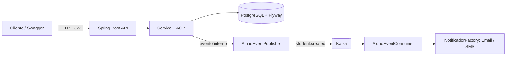

# Escola – Sistema de Gestão (Projeto Final)

API REST em **Java 21 + Spring Boot 3** para gestão de alunos, com autenticação JWT, eventos Kafka, PostgreSQL + Flyway e Docker.

## Arquitetura

**Monólito modular** (pacotes independentes por domínio, comunicação por eventos). Escolhido porque o domínio é pequeno e a equipe é uma só: microsserviços adicionariam custo operacional sem ganho. Os módulos já estão separados e o evento `student.created` no Kafka permite extrair o módulo de notificações como serviço próprio no futuro.



Camadas: `controller → service → repository`; entidades nunca são expostas (DTOs com validação).

## Como executar

**Tudo em Docker** (API + PostgreSQL + Kafka):

```bash
docker compose up -d --build
# Swagger: http://localhost:8080/swagger-ui.html
```

**API local + infraestrutura em Docker:**

```bash
docker compose up -d db kafka
mvn spring-boot:run
```

**Sem Docker (plano B, banco H2 em memória, Kafka desligado):**

```bash
mvn spring-boot:run -Dspring-boot.run.profiles=h2
```

Usuários de demonstração: `admin@escola.com / admin123` (ADMIN) e `prof@escola.com / prof123` (PROFESSOR).
Roteiro automatizado: `bash demo.sh`.

## Mapa dos critérios de avaliação

| Critério | Onde está |
|---|---|
| Autenticação e autorização | `security/JwtService`, `security/JwtAuthFilter`, `config/SecurityConfig`, `auth/*` (login, registro, verificação de e-mail e recuperação de senha simulados), `@PreAuthorize` nos controllers |
| Gestão de perfil / CRUD | `aluno/*` (CRUD, busca, paginação), exportação CSV/PDF em `GET /alunos/export` |
| POA (AOP) | `aop/LogAspect` (tempo de execução), `aop/AuditAspect` (auditoria de quem alterou dados) |
| Modelo arquitetural | Monólito modular (seção acima) |
| Padrões de projeto (3+) | ver tabela abaixo |
| Outras funcionalidades | Notificações (`notificacao/*`), relatório `GET /relatorios/alunos-por-curso` |
| Kafka | `event/AlunoEventPublisher` (produtor), `event/AlunoEventConsumer` (consumidor), tópico `student.created` |
| PostgreSQL + Flyway | `db/migration/V1`, `V2`; `ddl-auto: validate` |
| Docker | `Dockerfile` (multi-stage) e `docker-compose.yml` (api, db, kafka) |
| Qualidade de código | camadas, DTOs, `@Valid`, `GlobalExceptionHandler`, teste unitário `ExportTest` |

### Padrões de projeto

| Padrão | Classe | Motivo |
|---|---|---|
| Builder | `Aluno`, `User` (`@Builder`) | criação legível de objetos com muitos campos |
| Strategy | `ExportStrategy` + `CsvExport`/`PdfExport` | novo formato = nova classe, sem alterar o controller |
| Factory | `ExportFactory`, `NotificadorFactory` | escolhe a implementação sem `if/else` |
| Observer | `AlunoCriadoEvent` + `@EventListener` | desacopla o cadastro do envio de eventos |
| Singleton | beans do Spring | uma instância por serviço |

## Requisitos não funcionais

- **Desempenho:** `LogAspect` mede cada serviço e alerta acima de 2 s; índices em `V2__add_indexes.sql`; paginação (`Pageable`).
- **Segurança:** senhas com BCrypt, JWT stateless, segredo e credenciais por variável de ambiente, papéis ADMIN/PROFESSOR/ALUNO.
- **LGPD:** coleta mínima de dados, exclusão de aluno (`DELETE /alunos/{id}`), auditoria de alterações, nenhuma senha em texto puro.
- **Escalabilidade:** API stateless (JWT) + Docker permitem várias réplicas atrás de um balanceador.
- **UX:** Swagger UI para teste interativo; mensagens de erro claras em JSON.

## Limitações conhecidas

Tokens de verificação de e-mail e recuperação de senha ficam em memória e o envio de e-mail/SMS é simulado em log. Não há front-end nesta entrega.
